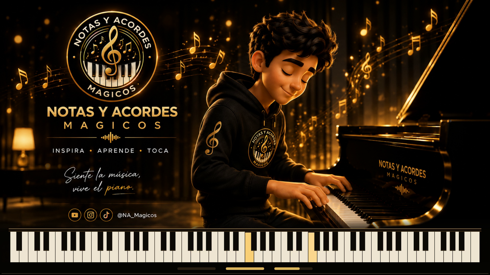
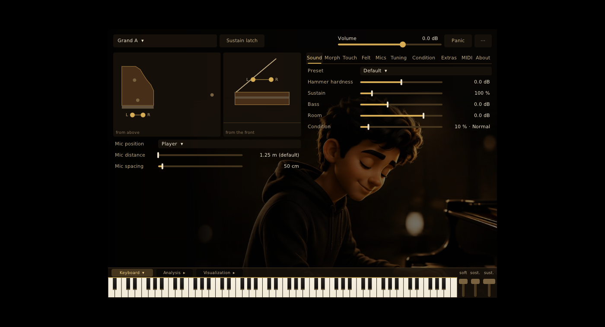

# NA_Magicos – edición de Dussek

Cambios de este fork para el canal **@NA_Magicos**, sobre el código original de
[ccoors/dussek](https://github.com/ccoors/dussek) (código AGPL-3.0; instrumentos CC BY 4.0).

## Tema de video "Art déco dorado"

`midi2wav` / `dussek render` aceptan `--theme deco` junto a `--video`: fondo negro con resplandor cálido,
rayos de sol art déco, doble marco dorado con esquinas escalonadas, cuerdas de cobre a oro y perla,
teclas de marfil y ébano con filo dorado. `--theme classic` (por defecto) deja el visual original.


```
dussek render instruments/grand_b pieza.mid pieza.wav --video pieza.mp4 --theme deco
```

## Video con el arte de portada

`--background IMAGEN.png` (junto a `--video`) pone la imagen de fondo tal cual, cubriendo todo el cuadro, y dibuja
encima solo el teclado y los pedales, sincronizados nota por nota. Con `--theme deco`, el teclado lleva filo dorado.
`render-namagicos.ps1` lo usa por defecto en el video horizontal con `arte_portada_hd.png` (`-SinFondo` lo quita);
con un `dussek.exe` 0.4.1, que no tiene `--background`, arma lo mismo con ffmpeg.



## Interfaz en vivo NA_Magicos

La ventana de Dussek usa la paleta del canal: negro y nogal, acentos dorados y texto marfil
(`plugin/src/ui/Theme.hpp`); el pianista de fondo en el espacio libre (`CoverArt.inc`, sin textos);
teclado de marfil y ébano con brillo, filo dorado en las negras y regla dorada; cuerdas de cobre a perla.



## Presets (`presets/`)

Copiar a `%APPDATA%\Dussek\presets\` (Windows):

- **NA Magicos - Nocturno calido**: Grand B, micrófonos de audiencia, martillo más suave, sustain 115 %.
- **NA Magicos - Lofi intimo**: Upright C, martillo muy suave, poca sala.

Ambos con una curva de velocidad para el Yamaha YPG-235 (teclas sin peso).

## Scripts

- `render-namagicos.ps1`: MIDI → WAV a −14 LUFS + video (horizontal, Short "Dos mundos" con el clip del
  personaje, o transparente), opcionalmente con pad (`-Pad`) y limitador (`-Limitar`). Usa el tema Deco
  si el `dussek.exe` lo trae; si no, el clásico.
- `pad_from_midi.py`: genera un pad sincronizado a partir de los acordes del MIDI y lo mezcla bajo el piano
  (`py -3 -m pip install numpy scipy mido soundfile`).
